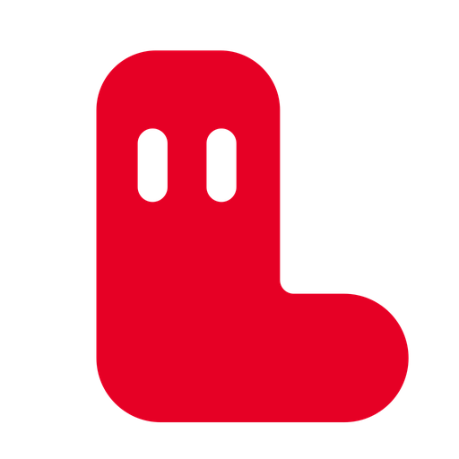
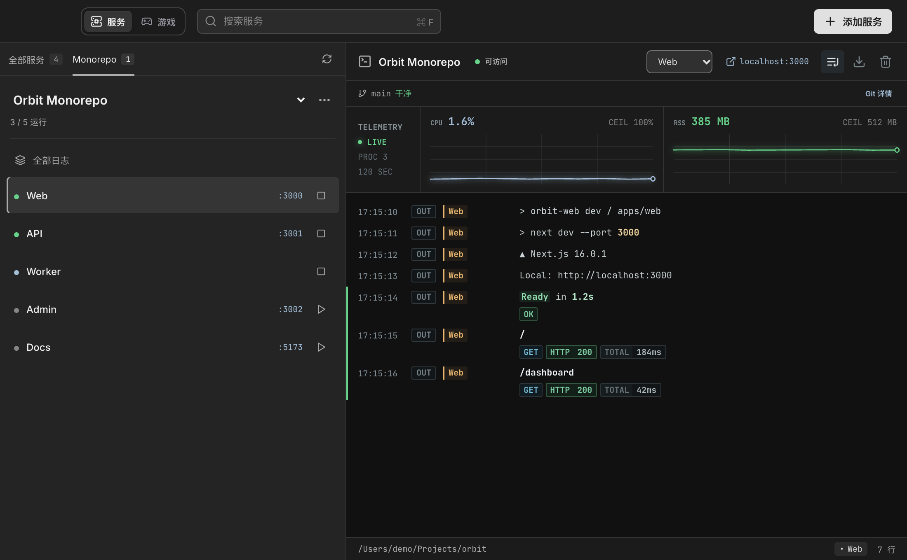
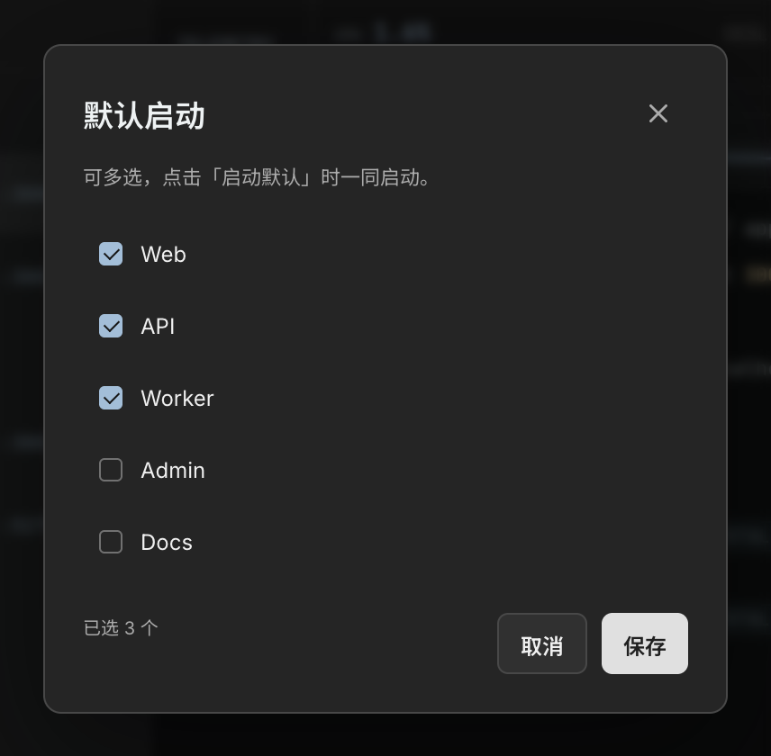
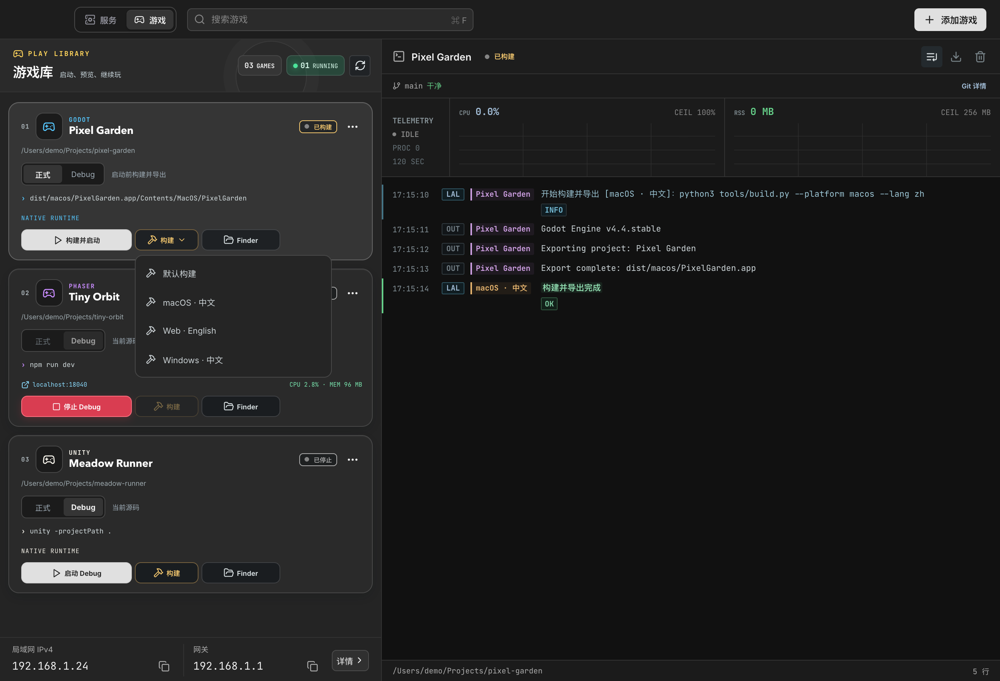

<p align="center">
  
</p>

<h1 align="center">LAL · Local App Launcher</h1>

<p align="center"><a href="README.md">简体中文</a> · <strong>English</strong></p>
<p align="center"><strong>One click back to your development session.</strong></p>
<p align="center">A local development workbench for macOS. Manage monorepos, development servers and games in one app.</p>
<p align="center">
  <a href="#getting-started">Getting started</a> · <a href="#start-your-monorepo-your-way">Monorepos</a> · <a href="#a-home-for-your-game-projects">Game development</a> · <a href="reference/README.en.md">Reference</a>
</p>



Web, API and worker processes often need to run together. LAL keeps their launch controls, URLs and logs in one workbench. Save the combination you use, then start it again with a click.

## Start your monorepo, your way

Add the repository once. Switch projects in the dedicated Monorepo view, where each service gets one row: status, name, port and a start/stop control.

Open the project's “... → 配置默认启动” (Configure default startup), select several services and save. “启动默认” (Start defaults) launches that combination. You can change defaults while services are running; the new selection applies to the next default start.

<p align="center"></p>

Each service also keeps its own start/stop control and URL. Start another service directly from its row whenever you need it.

## Logs follow your selection

Click a service to see its logs in the right pane. Switch processes from the log panel, or choose all logs for the complete project. The selected service and log filter stay in sync.

Port reachability and CPU / memory trends sit alongside the logs. When a build or script fails, LAL highlights the failure and offers a repair prompt with the executed command and error context, ready to copy into Codex or another coding agent.

## A home for your game projects

Godot, Unity and Phaser / Web games have their own library. Choose Debug or Release startup, optionally build before launching Release, or save named export profiles such as “macOS · 中文” and “Web · English” and run them from the Build menu.



Services and games have separate controls. Starting all services applies to the service module. Install game engines and project runtimes separately.

## Everyday development tasks

| What you need | In LAL |
| --- | --- |
| Organize projects | Group them into Workspaces, search, collapse groups and move projects in bulk |
| Start or stop several services | Use batch controls or a project's saved default combination |
| Check repository context | Inspect branches, changes and conflicts; edit repository-local Git configuration |
| Run a project task | Execute root `package.json` scripts and inspect their logs |
| Diagnose local access | Inspect port ownership and network interfaces; copy LAN IPv4 and gateway addresses |

## Getting started

This page shows the current source version with demo data. Build from source for the full feature set; see the notes for each [published preview](https://github.com/yayapao/lal/releases) for its included features. The UI is currently in Chinese.

### Build from source

You need macOS 12+, Xcode Command Line Tools, Go 1.26+ (toolchain pinned to 1.26.10), Node.js 20.19+ on the 20.x line or 22.12+, and npm.

```bash
git clone https://github.com/yayapao/lal.git
cd lal

go install github.com/wailsapp/wails/v3/cmd/wails3@v3.1.0
npm --prefix frontend ci
scripts/build-macos.sh
open "$HOME/Applications/LAL.app"
```

Make sure Go's bin directory is on your `PATH`. The script builds a universal app for Apple Silicon and Intel and installs it at `~/Applications/LAL.app`. Add `--no-install` to build only; the output is `build/bin/LAL.app`.

### Add your project

1. Click “添加服务” (Add service), choose the project root, review the detected command and URL, choose a Workspace and save.
2. For a monorepo, declare services in a root `.lal.json`; LAL reads them when you add the project. For an existing project, import them through “项目进程 → 从项目读取” (Project processes → Read from project) in the editor.
3. Switch to the Monorepo view, configure a default combination and click “启动默认” (Start defaults). For a single service, use its card's start button.
4. Click a service to inspect logs or open its URL. Switch to “游戏” (Games) to add a game.

<details>
<summary><strong>Example .lal.json: start Web and API together</strong></summary>

```json
{
  "launchTargets": [
    {
      "id": "web",
      "name": "Web",
      "command": "npm run dev:web",
      "url": "http://localhost:3000",
      "default": true
    },
    {
      "id": "api",
      "name": "API",
      "command": "npm run dev:api",
      "url": "http://localhost:3001",
      "default": true
    }
  ]
}
```

Commands run in the project root. The project handles dependencies and readiness order. You can change the saved default combination in the UI.

</details>

Projects and Workspaces are stored locally, with no account required. Commands run through zsh and load `~/.zshrc`; install the required runtimes and review configured commands. “可访问” means the TCP port is reachable.

## More

- [Configuration and usage](reference/README.en.md): process declarations, game exports, local data and process management.
- [Development and contributing](reference/CONTRIBUTING.en.md): development commands, checks and project structure.
- [Report an issue](https://github.com/yayapao/lal/issues): include your macOS version, project type and reproduction steps.

[MIT](LICENSE) © 2026 Yango. Third-party dependencies and bundled fonts retain their own licenses.
