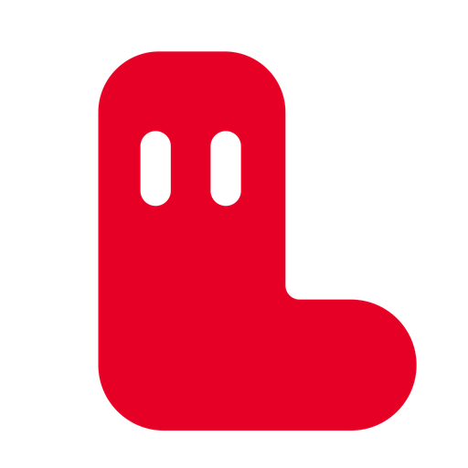
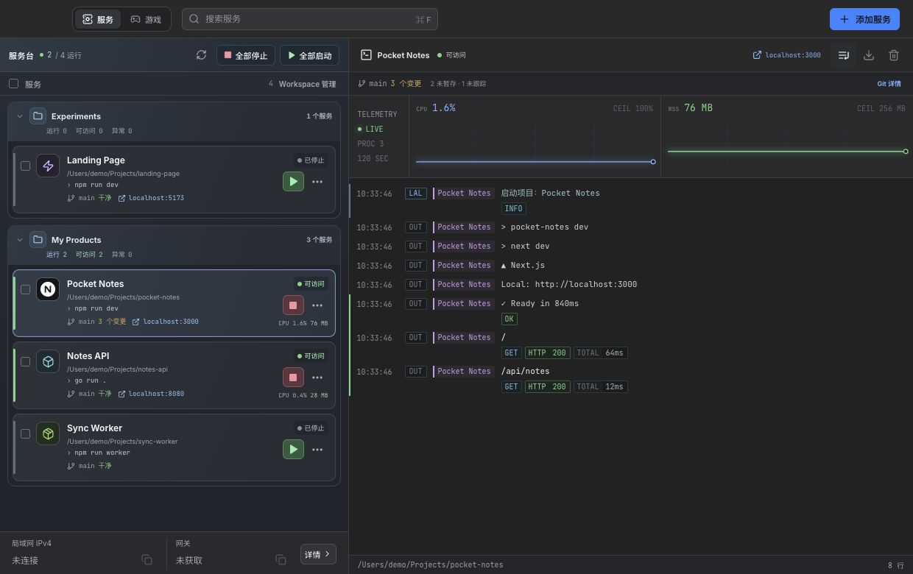
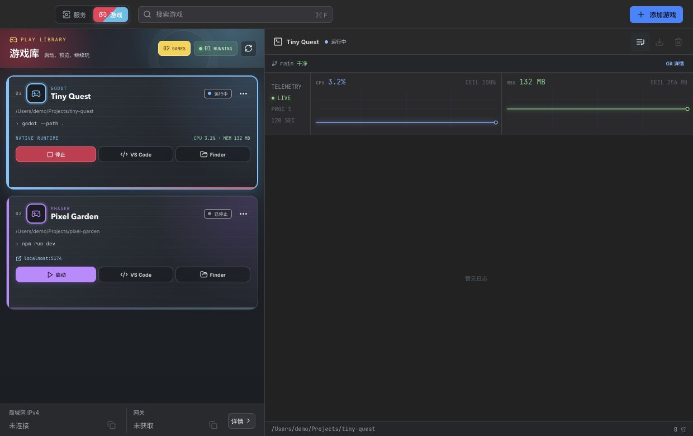

<p align="center">
  
</p>

<h1 align="center">LAL · Local App Launcher</h1>

<p align="center"><a href="README.md">简体中文</a> · <strong>English</strong></p>

<p align="center"><strong>AI helps you build more projects. LAL helps you run them.</strong></p>
<p align="center">A local project manager for macOS: launch development servers and games, inspect logs, ports and Git, and get back to building.</p>
<p align="center">
  <a href="#getting-started">Getting started</a> · <a href="#features">Features</a> · <a href="reference/README.en.md">Reference</a> · <a href="LICENSE">MIT License</a>
</p>



As projects multiply, their folders, terminals, ports and startup commands become harder to track. LAL groups projects on your computer into Workspaces so you can start and stop them, open their pages and inspect their running state in one place.

## Features

| Capability | What you can do |
| --- | --- |
| Services | Detect startup commands and URLs; start or stop one, several or all services |
| Games | Detect Godot, Unity and Phaser / Web projects; configure launch, preview and cache cleanup |
| Workspaces | Group projects by product or workflow, search, collapse groups and move projects in bulk |
| Diagnostics | Inspect live logs, CPU / memory trends, PID, uptime and port ownership; export logs |
| Development context | Inspect Git branches, changes and conflicts; edit repository-local Git configuration; open VS Code / Finder |
| Prompts and tasks | Read project Markdown prompts, copy or paste them into Codex without sending, and run `package.json` scripts |



Services and games are managed separately; starting all services does not launch games. “可访问” means the TCP port is reachable. Install Godot / Unity separately. See [Reference](reference/README.en.md#status-and-engines) for details.

## Getting started

### Download the app

Download the [macOS universal preview from Releases](https://github.com/yayapao/lal/releases/tag/v0.1.0) for Apple Silicon and Intel. Verify it against `SHA256SUMS.txt` on the release page, extract the archive, and drag `LAL.app` into your Applications folder.

The preview uses an ad-hoc signature and has not been signed with Developer ID or notarized by Apple. macOS may block it from opening; see the release notes for signing status and validation scope. The current UI is primarily Chinese, and desktop integrations target macOS.

### Add your first project

1. Click “添加服务” (Add service), choose a project folder, and review the detected launch command and URL.
2. Choose or create a Workspace, save, and click the green start button.
3. Open the project's URL, or inspect its logs and resource trends in the right pane.
4. To add a game, switch to “游戏” (Games) and choose its project folder.

Install the runtimes, package managers and game engines your projects need. LAL runs startup commands through zsh in the project folder and loads `~/.zshrc`; review commands before running them.

### Build from source

You need macOS 12+, Xcode Command Line Tools, Go 1.26+ (toolchain pinned to 1.26.10), Node.js 20.19+ on the 20.x line or 22.12+, and npm.

```bash
git clone https://github.com/yayapao/lal.git
cd lal

go install github.com/wailsapp/wails/v3/cmd/wails3@v3.1.0
npm --prefix frontend ci
scripts/build-macos.sh
open "$HOME/Applications/LAL.app"
```

Make sure Go's bin directory is on your `PATH` so you can run `wails3`. The script builds a universal app and installs it at `~/Applications/LAL.app`. Add `--no-install` to build without installing; the app is written to `build/bin/LAL.app`.

## More

- [Configuration and usage boundaries](reference/README.en.md): `.lal.json`, local data, process management and permissions.
- [Development and contributing](reference/CONTRIBUTING.en.md): development commands, checks, project structure and bug reports.
- [Recording demos](reference/README.en.md#recording-demos): open-source recording tools, GIF / video guidance and recording sequences.

[MIT](LICENSE) © 2026 Yango. Third-party dependencies and bundled fonts retain their own licenses.
