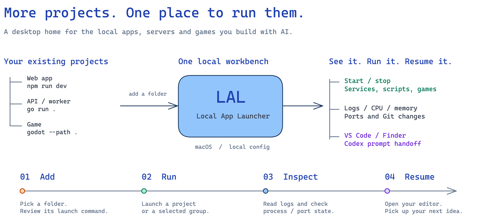

<p align="center">
  
</p>

<h1 align="center">LAL · Local App Launcher</h1>

<p align="center"><strong>AI 帮你写出更多项目，LAL 帮你把它们跑起来。</strong></p>
<p align="center">A local project manager for macOS — launch dev servers and games, inspect logs, ports and Git, and get back to building.</p>
<p align="center">
  <a href="#开始使用">开始使用</a> · <a href="#一个窗口管理开发现场">功能预览</a> · <a href="#参与项目">参与项目</a> · <a href="LICENSE">MIT License</a>
</p>



## 为什么做 LAL

用 AI 编程，做出一个 Web 应用、一个 API 或一个小游戏越来越容易。项目一多，目录、终端、端口、启动命令和上下文就散落在各处：昨天的 Demo 放在哪？哪个服务占着端口？这次改完为什么启动失败？

LAL 是一个 **macOS 本地项目启动器与开发工作台**。把已经在电脑上的项目加入 Workspace，集中启动、停止、打开页面、查看日志和 Git 状态。适合同时维护多个仓库的独立开发者，也适合刚开始用 AI 做产品的人。

LAL 使用 Go、Wails 和 React 构建。你继续使用熟悉的编辑器、终端和 AI 编程工具，LAL 负责把项目的运行现场放到一起。

## 一个窗口，管理开发现场

### 服务：从“进程已启动”看到“端口可连接”


- **项目识别**：选择目录后读取 `package.json`、常见启动脚本与端口配置，建议名称、命令和访问地址；可手动修改。
- **集中启停**：单个、多选或全部启动与停止；按名称稳定排序。绿色启动、红色停止，运行状态变化不会打乱列表。
- **Workspace**：按产品或工作场景分组，支持折叠、搜索、重命名和项目批量移动。
- **诊断现场**：实时 stdout / stderr 日志、日志下载、CPU / 内存趋势、PID、运行时长、异常退出与端口占用信息。

状态中的“可访问”表示配置地址对应的 **TCP 端口可连接**，不代表 HTTP 接口或业务健康检查已通过。外部进程与 LAL 启动的进程会区分展示；停止外部进程需要在界面中明确确认。

### 游戏：让原生与 Web 项目都有自己的入口


识别 Godot、Unity 和 Phaser / Web 游戏项目，集中配置启动命令、预览地址与资源缓存清理命令。卡片提供启动、停止、VS Code 和 Finder 快捷入口。游戏与服务分别展示，“全部启动服务”不会启动游戏。

原生游戏的启动状态与 Web 预览服务独立判断。Godot 或 Unity 需要自行安装；LAL 不包含游戏引擎。

### 接回开发上下文

| 想做什么 | LAL 提供的入口 |
| --- | --- |
| 继续修改项目 | 从项目菜单打开 VS Code 或 Finder |
| 确认仓库状态 | 查看分支、变更文件、冲突与仓库本地 Git 配置 |
| 继续用 Codex 开发 | 读取项目 `prompts/` 中的 Markdown，复制或打开 Codex 并粘贴；不会自动发送 |
| 在手机上打开本地页面 | 查看和复制局域网 IPv4、网关，展开网络接口详情 |
| 执行项目已有任务 | 选择 `package.json` 脚本并查看执行日志 |

界面截图均来自实际前端，使用演示项目与演示数据。功能示意图的[可编辑 Excalidraw 源文件](assets/readme/overview.excalidraw)随仓库保留。

## 开始使用

目前通过源码构建；仓库尚未提供可下载的 Release。当前界面主要为中文，桌面集成面向 macOS。

需要 macOS、Xcode Command Line Tools、Go 1.25+、Node.js 20.19+（20.x）或 22.12+、npm。项目使用的包管理器和运行环境也需要安装在本机。

```bash
git clone https://github.com/yayapao/lal.git
cd lal

go install github.com/wailsapp/wails/v2/cmd/wails@v2.15.0
npm --prefix frontend ci
scripts/build-macos.sh
open "$HOME/Applications/LAL.app"
```

请确认 Go 的 bin 目录在 `PATH` 中，能直接运行 `wails`。构建脚本默认生成 Apple Silicon / Intel 通用应用并安装到 `~/Applications/LAL.app`；`scripts/build-macos.sh --no-install` 只构建，产物位于 `build/bin/LAL.app`。

首次打开是空项目列表：

1. 点击“添加服务”，选择自己的项目目录，检查识别出的启动命令和访问地址。
2. 选择或新建 Workspace，保存后点击绿色启动按钮。
3. 打开访问地址，或在右侧观察日志与资源趋势。
4. 添加游戏时切换到“游戏”模块，再选择项目目录。

例如，已有 Vite 项目可配置为目录 `~/Projects/my-web`、命令 `npm run dev`、地址 `http://localhost:5173`。自动识别不明确时，可在项目根目录创建 `.lal.json` 指定访问地址：

```json
{
  "url": "http://localhost:5173"
}
```

该文件仅作为元数据读取；它不包含启动命令，也不会被执行。

### 本地数据与执行边界

- 项目列表与 Workspace 保存到 `~/Library/Application Support/LAL/config.json`。LAL 不要求账号或云同步；启动你自己的项目仍可能产生该项目的网络请求。
- 启动命令在项目目录中通过 zsh 执行，并加载 `~/.zshrc`。只添加你信任的项目，运行前检查启动命令与缓存清理命令。
- 清理命令由你配置；默认值 `rm -rf .next` 适用于部分 Next.js 项目，请按项目修改。
- 常规停止与退出清理针对本次由 LAL 启动的进程。外部端口占用会先展示诊断，不会自动停止；目录匹配时可确认停止后交由 LAL 启动。
- Git 配置编辑只写当前仓库的 local 配置；不修改 global / system 配置。
- Codex 自动粘贴可能需要 macOS 辅助功能权限；未授权时仍可手动复制提示词。VS Code 快捷入口需要安装 VS Code。

## 开发与贡献

```bash
# 开发 LAL 桌面端
wails dev

# 验证 Go 后端
go test -race ./...
go vet ./...

# 验证前端
cd frontend
npm test
npm run build
```

目录按职责组织：

```text
lal/
├── main.go, app.go, menubar*.go  # Wails 入口、桥接与 macOS 状态栏
├── internal/launcher/           # 后端实现与同包测试
├── frontend/                    # React 界面、测试与生成的 Wails 绑定
├── assets/readme/               # 介绍图、截图与 Excalidraw 源文件
├── build/                       # 应用图标与平台打包配置
└── scripts/                     # 构建与本地开发工具
```

手写源文件保持在 300 行以内；`frontend/wailsjs/` 由 Wails 自动生成，后端类型变化时应重新生成绑定。

## 参与项目

欢迎通过 [Issues](https://github.com/yayapao/lal/issues) 分享多项目开发中的具体问题，或提交 Pull Request。报错时请附 macOS 版本、项目类型、复现步骤，以及已去除敏感信息的命令与日志。

LAL 聚焦单机本地项目管理。目前不提供远程部署、团队权限或启动依赖编排。

<details>
<summary>English overview</summary>

**LAL (Local App Launcher)** is a macOS desktop workbench for people building several projects with AI coding tools. Keep local development servers, scripts and games in one place: group projects into workspaces, start and stop processes, inspect logs and resource usage, diagnose occupied ports, review Git changes, and open your editor or project folder.

LAL supports Godot, Unity and Web game projects alongside regular services. Codex prompt handoff helps resume project context without sending prompts automatically. It runs locally with Go, Wails and React; the current UI is primarily Chinese. Build from source using the commands above; downloadable releases are not available yet.

</details>

## 许可证

[MIT](LICENSE) © 2026 Yango。第三方依赖及随附字体遵循各自许可证。
