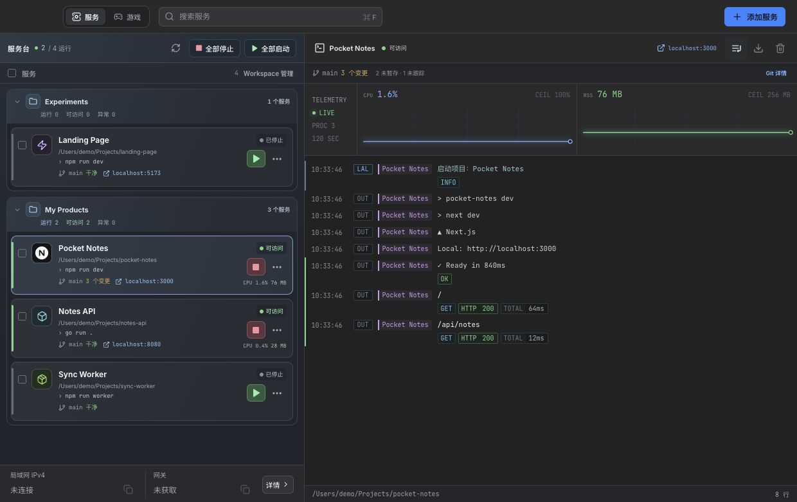
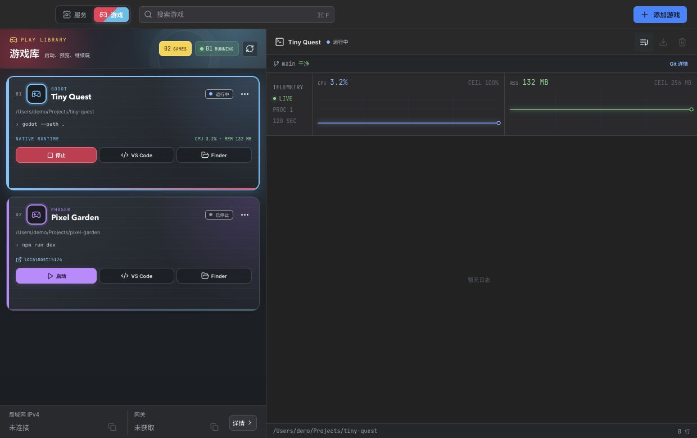

<p align="center">
  
</p>

<h1 align="center">LAL · Local App Launcher</h1>

<p align="center"><strong>简体中文</strong> · <a href="README.en.md">English</a></p>

<p align="center"><strong>AI 帮你写出更多项目，LAL 帮你把它们跑起来。</strong></p>
<p align="center">macOS 本地项目管理器：启动开发服务与游戏，查看日志、端口和 Git 状态。</p>
<p align="center">
  <a href="#开始使用">开始使用</a> · <a href="#功能预览">功能预览</a> · <a href="reference/README.md">Reference</a> · <a href="LICENSE">MIT License</a>
</p>



项目一多，目录、终端、端口和启动命令就容易散落在各处。LAL 把电脑上的项目放进 Workspace，集中启动、停止、打开页面和查看运行状态，让你随时接回开发现场。

## 功能预览

| 能力 | 可以做什么 |
| --- | --- |
| 服务管理 | 识别项目的启动命令与访问地址，单个、多选或全部启停服务 |
| 游戏管理 | 识别 Godot、Unity、Phaser / Web 项目，配置启动、预览与资源缓存清理 |
| Workspace | 按产品或场景分组，搜索项目、折叠分组、批量移动 |
| 运行诊断 | 查看实时日志、CPU / 内存趋势、PID、运行时长和端口占用，导出日志 |
| 开发上下文 | 查看 Git 分支、变更和冲突，编辑仓库本地 Git 配置；一键打开 VS Code / Finder |
| Prompt 与任务 | 读取项目 Markdown Prompt，复制或粘贴到 Codex（不自动发送）；执行 `package.json` 脚本 |



服务与游戏分别管理，“全部启动服务”不会启动游戏。“可访问”表示 TCP 端口可连接；Godot / Unity 需自行安装。更多说明见 [Reference](reference/README.md#状态与引擎)。

## 开始使用

### 下载应用

从 [Releases 下载 macOS 通用预览版](https://github.com/yayapao/lal/releases/tag/v0.1.0)（Apple Silicon / Intel），校验同页的 `SHA256SUMS.txt`，解压后将 `LAL.app` 拖入 Applications 文件夹。

预览版采用 ad-hoc 签名，尚未做 Developer ID 签名与 Apple 公证，macOS 可能阻止打开；签名状态和验收范围见 Release 说明。当前界面主要为中文，桌面集成面向 macOS。

### 添加第一个项目

1. 点击“添加服务”，选择项目目录，检查识别出的启动命令和访问地址。
2. 选择或新建 Workspace，保存后点击绿色启动按钮。
3. 打开访问地址，或在右侧查看日志与资源趋势。
4. 添加游戏时切换到“游戏”模块，再选择项目目录。

项目所需的运行环境、包管理器和游戏引擎需要预先安装。LAL 的启动命令会在项目目录中通过 zsh 执行，并加载 `~/.zshrc`；运行前请检查命令。

### 从源码构建

需要 macOS 12+、Xcode Command Line Tools、Go 1.26+（工具链固定为 1.26.10）、Node.js 20.19+（20.x）或 22.12+、npm。

```bash
git clone https://github.com/yayapao/lal.git
cd lal

go install github.com/wailsapp/wails/v3/cmd/wails3@v3.1.0
npm --prefix frontend ci
scripts/build-macos.sh
open "$HOME/Applications/LAL.app"
```

确保 Go 的 bin 目录在 `PATH` 中，能直接运行 `wails3`。脚本默认构建通用应用并安装到 `~/Applications/LAL.app`；加 `--no-install` 只构建，产物位于 `build/bin/LAL.app`。

## 更多

- [配置与使用边界](reference/README.md)：`.lal.json`、本地数据、进程管理与权限说明。
- [开发与贡献](reference/CONTRIBUTING.md)：开发命令、验证方式、目录结构与问题反馈。
- [操作演示制作](reference/README.md#操作演示制作)：开源录屏工具、GIF / 视频规范与录制流程。

[MIT](LICENSE) © 2026 Yango。第三方依赖及随附字体遵循各自许可证。
