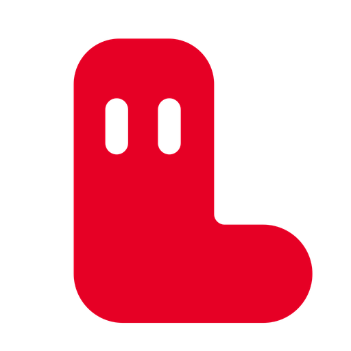
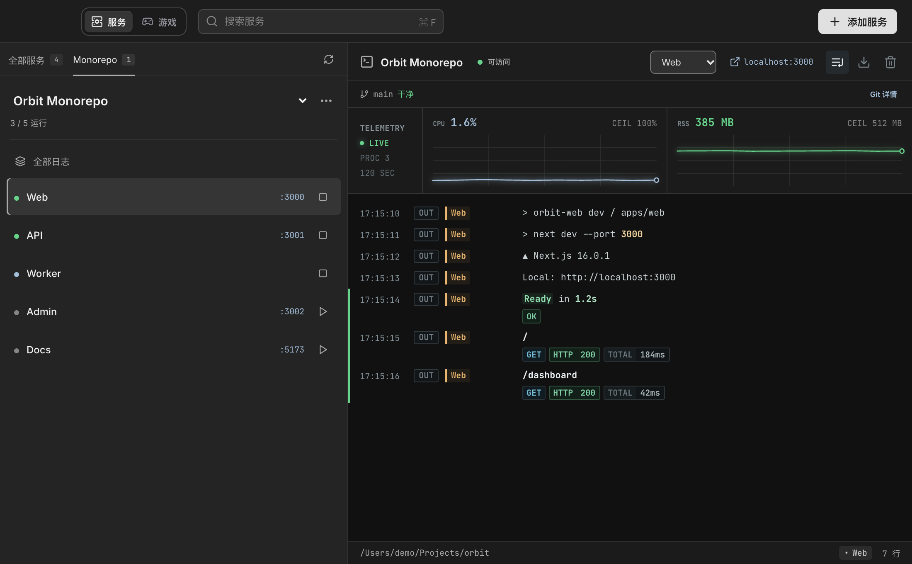
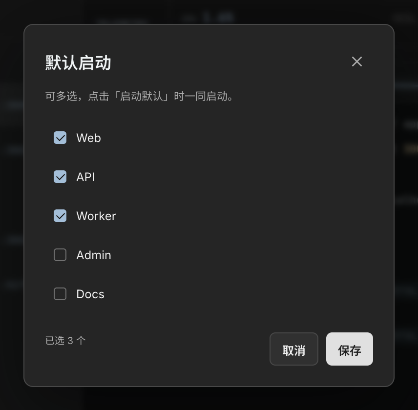
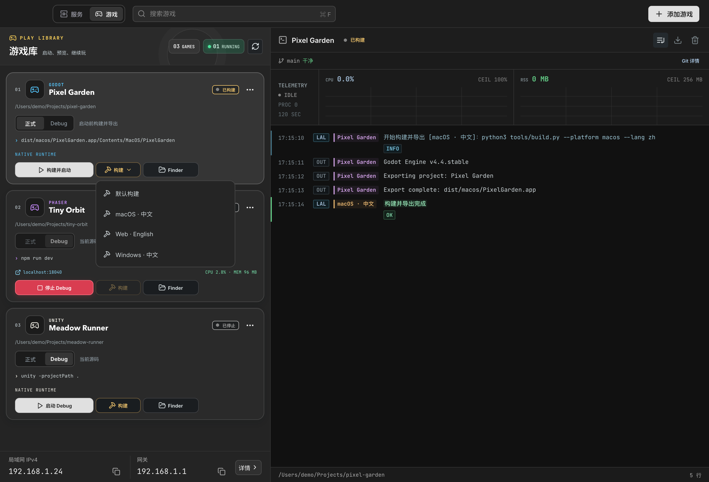

<p align="center">
  
</p>

<h1 align="center">LAL · Local App Launcher</h1>

<p align="center"><strong>简体中文</strong> · <a href="README.en.md">English</a></p>
<p align="center"><strong>一次启动，回到你的开发现场。</strong></p>
<p align="center">macOS 本地开发工作台，集中管理 Monorepo、开发服务和游戏。</p>
<p align="center">
  <a href="#开始使用">开始使用</a> · <a href="#monorepo按组合启动">Monorepo</a> · <a href="#游戏开发也在这里">游戏开发</a> · <a href="reference/README.md">Reference</a>
</p>



Web、API、Worker 往往要一起跑。LAL 把它们的启动入口、访问地址和日志放在同一个工作台，保存常用组合，下次一键接着开发。

## Monorepo，按组合启动

一个仓库只添加一次。在独立的 Monorepo 视图中切换项目，服务直接平铺：状态点、名称、端口、启停，一行就够。

打开项目的「… → 配置默认启动」，勾选 Web、API、Worker 等多个服务并保存。以后点击「启动默认」，就会启动这组服务。运行中也能调整组合，下次默认启动时生效。

<p align="center"></p>

每个服务仍可独立启停、打开页面。要补启动一个服务，直接点它的启动按钮即可。

## 日志跟着服务走

点击左侧的服务，右侧立即切到它的日志；也能从日志面板切换进程，或回到「全部日志」查看整个项目。进程选中态与日志筛选同步，定位问题时始终知道自己在看谁。

端口可达性与 CPU / 内存趋势放在同一界面。构建或脚本失败时，LAL 会标出失败片段，并提供「复制修复 Prompt」，带上执行命令和错误上下文，方便交给 Codex 或其他 coding agent 继续处理。

## 游戏开发也在这里

Godot、Unity、Phaser / Web 游戏有独立的游戏库。选择 Debug 或正式启动，按需在正式启动前构建；也可以保存多套打包方案，例如「macOS · 中文」「Web · English」，从构建菜单直接执行。



服务与游戏分别管理，批量启动服务只作用于服务模块。游戏引擎与项目运行环境由你自行安装。

## 日常开发，顺手处理

| 想做什么 | 在 LAL 中 |
| --- | --- |
| 整理多个项目 | 用 Workspace 分组，搜索、折叠或批量移动项目 |
| 同时启停一组服务 | 多选服务批量操作，或使用项目保存的默认启动组合 |
| 接回仓库上下文 | 查看分支、变更与冲突，编辑仓库本地 Git 配置 |
| 跑一次项目任务 | 直接执行根项目的 `package.json` 脚本，查看执行日志 |
| 排查本地访问问题 | 查看端口占用与网络接口，复制局域网 IPv4、网关 |

## 开始使用

页面展示当前源码的界面与功能，截图均为演示数据。要体验完整功能，请从源码构建；[已发布的预览包](https://github.com/yayapao/lal/releases)以对应版本说明为准。

### 从源码构建

需要 macOS 12+、Xcode Command Line Tools、Go 1.26+（工具链固定为 1.26.10）、Node.js 20.19+（20.x）或 22.12+、npm。

```bash
git clone https://github.com/yayapao/lal.git
cd lal

go install github.com/wailsapp/wails/v3/cmd/wails3@v3.1.0
npm --prefix frontend ci
scripts/build-macos.sh
open "$HOME/Applications/LAL.app"
```

确保 Go 的 bin 目录在 `PATH` 中。脚本构建 Apple Silicon / Intel 通用应用并安装到 `~/Applications/LAL.app`；加 `--no-install` 仅构建，产物位于 `build/bin/LAL.app`。

### 添加你的项目

1. 点击「添加服务」，选择项目根目录，确认识别出的命令和地址，选择 Workspace 后保存。
2. Monorepo 在根目录的 `.lal.json` 中声明多个服务，添加时自动读取；已有项目可在编辑配置中点击「项目进程 → 从项目读取」导入。
3. 切到 Monorepo 视图，配置默认启动组合，再点击「启动默认」。普通服务可直接点击卡片上的启动按钮。
4. 点击服务查看日志、打开访问地址。添加游戏时，切换到「游戏」模块。

<details>
<summary><strong>.lal.json 示例：同时启动 Web 和 API</strong></summary>

```json
{
  "launchTargets": [
    {
      "id": "web",
      "name": "Web",
      "command": "npm run dev:web",
      "url": "http://localhost:3000",
      "default": true
    },
    {
      "id": "api",
      "name": "API",
      "command": "npm run dev:api",
      "url": "http://localhost:3001",
      "default": true
    }
  ]
}
```

命令在项目根目录执行；服务之间的依赖和就绪顺序由项目自行处理。保存后，也可以在界面中修改默认组合。

</details>

项目和 Workspace 保存在本机，无需账号。启动命令通过 zsh 执行并加载 `~/.zshrc`；请预先安装项目需要的运行环境，并确认配置的命令。「可访问」表示 TCP 端口可连接。

## 更多

- [配置与使用说明](reference/README.md)：多进程声明、游戏打包、本地数据与进程管理。
- [开发与贡献](reference/CONTRIBUTING.md)：开发命令、验证方式与项目结构。
- [反馈问题](https://github.com/yayapao/lal/issues)：附上 macOS 版本、项目类型与复现步骤。

[MIT](LICENSE) © 2026 Yango。第三方依赖及随附字体遵循各自许可证。
